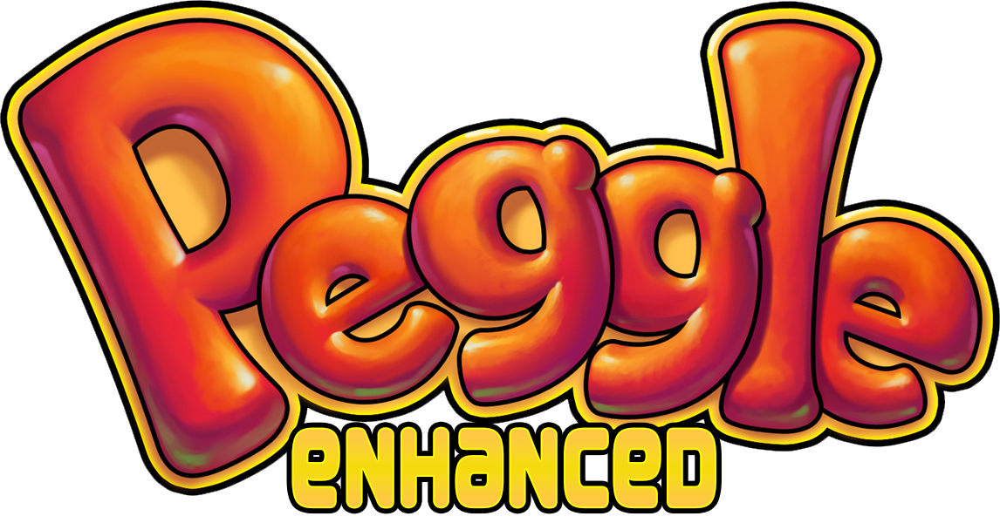

<p align="center">
  
</p>

# Peggle Enhanced

By aidrum and TheAwesomeBlue

Peggle Enhanced is a Peggle iOS decompilation ported to MonoGame, available for Android and Windows. It features the complete Peggle, Peggle Nights, Peggle Extreme and Peggle World of Warcraft adventures! It includes both the original version adapted for ultrawide and the HD version for tablets.

While Windows builds are offered, this project is mostly intended for Android phones and tablets. You're still recommended to play the original version of each game on Windows, as this version is optimized for mobile.

## How was this made?

Using [PlantsVsZombies.NET](https://github.com/Mewnojs/PlantsVsZombies.NET) by Mewnojs and [Bejeweled Plus](https://github.com/ariidesu/BejeweledPlus) by ariidesu as a base for the mobile SexyAppFramework being ported to MonoGame, the Objective C iOS code was decompiled with Ghidra, migrated to C# and fixed/expanded from there. This is a fully native port, there are no weird emulation layers here. Additionally, many animations were ported from the original PC versions of Peggle Nights, Peggle Extreme and Peggle WoW.

While it was vibecoded, it has been tested properly and all games should be completable. Please let us know if you encounter any bugs or inconsistencies. Keep in mind that a few differences from the PC version may have been carried over from the original Peggle mobile version and are working as intended, but feel free to report them anyways if you think they're important.

## Why was this made?

This was made due to the original Android version of Peggle not working properly on modern devices, having weird audio issues or even not being installable on certain devices. This version has higher quality graphics, extra levels ported from other games and ultrawide display support (non-HD only).
Essentially, we wanted to make Peggle more accessible for modern mobile phones.

Additionally, TheAwesomeBlue simply had a strange thought for a while now: It has to be possible to decompile Peggle's iOS version using the Plants vs. Zombies Windows Phone version as a base. Turns out, he was correct!

## iOS and macOS builds (experimental)

GitHub Actions build these for both editions (HD and iPhone). Open the **Actions** tab, pick a workflow, press **Run workflow**, then download the files from the finished run's **Artifacts** section. Pushes and pull requests also start these workflows.

- **iOS / iPadOS** (`iOS (unsigned IPA)` workflow): unsigned `.ipa` files that need iOS 15 or later. Install one with something that signs apps when it installs them: Sideloadly or AltStore/SideStore (with a free Apple ID), or TrollStore. Saves are kept in the app's Documents folder, which you can open in the Files app (On My iPhone/iPad).
- **macOS** (`macOS` workflow): `.app` bundles for Intel (`osx-x64`) and Apple Silicon (`osx-arm64`). They are only ad-hoc signed, so the first time you open one, right-click it and choose **Open**, or run `xattr -dr com.apple.quarantine "Peggle HD.app"`. Saves are kept in `~/Library/Application Support/Peggle Enhanced/`.

To build on a Mac yourself:

```sh
# macOS app: edition HD|iPhone, rid osx-x64|osx-arm64 -> distribution/out/
distribution/build_macos.sh HD osx-x64

# iOS (needs Xcode and `dotnet workload install ios`)
dotnet build Peggle.iOS -c Release -r ios-arm64 -p:PeggleEdition=HD -p:EnableCodeSigning=false
```

## FAQ

- **iOS version???**

  Maybe in the future, but right now we don't have the hardware to test or compile iOS apps. Would love to do it though.

- **Will this get any updates?**

  If we think of cool stuff to add, likely. If we have to fix bugs, definitetly. We may add the exclusive Peggle Dual Shot levels too, but don't count on it yet. The peg placements would have to be remade.

- **Will any other PopCap Games get the same treatment?**

  Bookworm is highly likely, the rest probably not. The reason being that there's already great ways of playing nearly all of the PopCap games that ever received an iOS port on modern Android. You can find these on the "MORE GAMES" button in-game.

- **What devices are supported?**

  Any Android device with an armv7, arm64 or x64 processor running Android 6.0 or later.

- **What Android devices was this tested on?**

  - Redmi Note 13 Pro 5G (Android 13): Great performance. All adventures were beaten here with no issues.
  - Huawei MediaPad T3 10 (Android 7): Great performance, briefly tested in a few levels.
  - Samsung Galaxy J2 Prime (Android 6): Great performance, relatively long initial loading time but the game itself runs well. Briefly tested in a few levels.

- **Why do some textures look different from the original iOS version?**

  On the non-HD version, a small number of textures were modified or added to make them look better on ultrawide displays. These replacement textures were taken from the Peggle console version.

- **Dynamic music??**

  Maybe in the future, but unlikely. If it does get added, it will be a setting due to performance concerns on lower end devices.

- **Was AI used to generate graphics or music?**

  Nope. AI was purely used for the game code. Graphical edits, app icon remakes and music additions were all done manually. This readme was written by hand too.

- **Why was AI used for the code?**

  We do not have the time or resources needed to do a full analysis of the iOS code manually. We playtested it for a while, even comparing it with real hardware to ensure the game was working right/accurately. (HD: iPad 3 - Original: iPhone 4S)